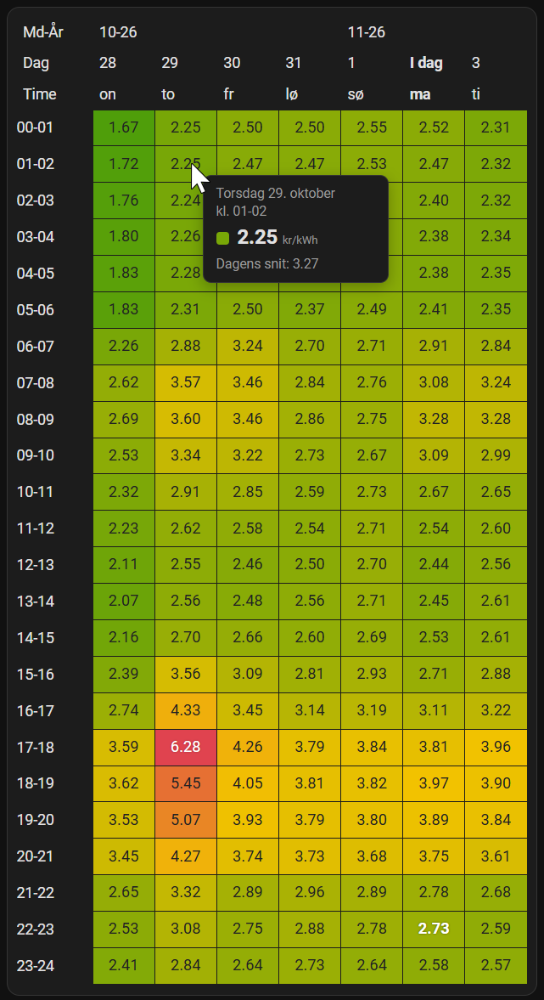

# Elpris heatmap card

Et lille custom card til Home Assistant, der viser elpriser som et heatmap: 24 timer som rækker og 7 dage som kolonner, med prisen skrevet i hvert felt. Grøn er billig, rød er dyr.



## Funktioner

- Heatmap over de seneste 7 dage, time for time
- Viser altid 7 dage: er i morgen tilgængelig, vises 5 dage tilbage, i dag og i morgen. Ellers vises 6 dage tilbage og i dag
- Den aktuelle time er markeret med hvid tekst
- Hvid tekst på de dyreste (mørkerøde) felter, så de er lette at læse
- Hover (eller tryk på mobil) viser en lille boks med dato, tidspunkt, pris og dagens gennemsnit
- Automatisk farveskala, eller faste grænser hvis du vil have farver, der betyder det samme hver dag
- Virker med både timepriser og kvarterspriser (der regnes gennemsnit pr. time)
- Ingen afhængigheder, f.eks. ikke apexcharts

## Krav

- [Strømligning](https://github.com/MTrab/stromligning)-integrationen til Home Assistant
- Prissensoren (fx `sensor.elpris_current_price_vat`) skal være med i recorderen, da tidligere dage hentes fra historikken. Standard er 10 dages historik, så 7 dage er fint

## Installation

Kortet er én enkelt JavaScript-fil. Du skal bare lægge den på din Home Assistant og fortælle dashboardet, at den findes.

### 1. Hent filen

Åbn `elpris-heatmap-card.js` her i repoet og klik på download-ikonet (*Download raw file*) øverst til højre for filvisningen. Gem filen på din computer.

### 2. Læg filen i `www`-mappen

Læg filen i mappen `/config/www/` på din Home Assistant. Det kan du gøre med f.eks. tilføjelsen *File editor*, *Studio Code Server* eller *Samba share*.

Findes mappen `www` ikke, så opret den og genstart Home Assistant én gang, så den bliver sat op.

Tjek, at det virker, ved at åbne `http://DIN-HA-ADRESSE:8123/local/elpris-heatmap-card.js` i browseren. Du skal se koden som tekst.

### 3. Tilføj filen som ressource

1. Slå *Avanceret tilstand* til under din profil (nederst til venstre i menuen).
2. Gå til **Indstillinger → Dashboards**, klik på **⋮** øverst til højre og vælg **Ressourcer**.
3. Klik **Tilføj ressource** og udfyld:
   - URL: `/local/elpris-heatmap-card.js?v=1`
   - Ressourcetype: **JavaScript-modul**
4. Gem og genindlæs browseren (Ctrl+F5).

### 4. Tilføj kortet

Rediger dit dashboard, vælg **Tilføj kort → Manuelt** og indsæt YAML'en herunder.

### Opdatering til en ny version

Erstat filen i `/config/www/`, ret derefter `?v=1` i ressourcen til `?v=2` (og så videre), og genindlæs browseren. Tallet tvinger browseren til at hente filen igen i stedet for at bruge en gammel kopi.

## Brug

Tilføj et manuelt kort på dit dashboard:

```yaml
type: custom:elpris-heatmap-card
entity: sensor.elpris_current_price_vat
tomorrow_entity: binary_sensor.elpris_tomorrow_available_vat
```

Eksempel med flere indstillinger:

```yaml
type: custom:elpris-heatmap-card
entity: sensor.elpris_current_price_vat
tomorrow_entity: binary_sensor.elpris_tomorrow_available_vat
title: Elpriser
decimal_separator: ","
min: 0.5
mid: 2.5
max: 5
white_text_from: 0.8
```

## Indstillinger

| Indstilling | Standard | Beskrivelse |
|---|---|---|
| `entity` | *(påkrævet)* | Prissensoren, fx `sensor.elpris_current_price_vat` |
| `tomorrow_entity` | – | Binær sensor, der er `on`, når i morgen er tilgængelig |
| `total_days` | `7` | Antal kolonner (dage) i alt |
| `title` | – | Overskrift over kortet |
| `decimals` | `2` | Antal decimaler i felterne |
| `decimal_separator` | `.` | Decimaltegn, fx `,` |
| `min` | automatisk | Pris, der får den grønne farve |
| `mid` | automatisk | Pris, der får den gule farve |
| `max` | automatisk | Pris, der får den røde farve |
| `white_text_from` | `0.85` | Hvid tekst fra denne placering på skalaen (0 til 1). Sæt til `1.1` for at slå fra |
| `row_padding` | `5` | Højde på rækkerne i pixels |

### Farveskalaen

Uden `min`, `mid` og `max` beregnes skalaen automatisk ud fra de viste dage: laveste pris er grøn, højeste er rød, og gul ligger midt imellem. Det betyder, at farverne er relative til de viste dage og kan skifte lidt, når en ny dag kommer til. Brug faste grænser, hvis en bestemt pris altid skal have samme farve.

## Sådan virker det

- **I dag og i morgen** læses fra attributten `prices` på prissensoren og på den binære sensor for i morgen. Hver post forventes at have `start` og `price`.
- **Tidligere dage** hentes fra Home Assistants historik for prissensoren og omregnes til et tidsvægtet gennemsnit pr. time.

## Fejlfinding

**`Custom element doesn't exist: elpris-heatmap-card`**
Filen er ikke indlæst. Tjek, at den er tilføjet under Ressourcer som *JavaScript-modul*, og genindlæs browseren.

**Kortet opdaterer sig ikke efter en ny version af filen**
Browseren cacher filen. Tæl versionsnummeret på ressource-URL'en op, fx `/local/elpris-heatmap-card.js?v=2`, og genindlæs.

**Felterne for tidligere dage er tomme**
Sensoren er enten ikke med i recorderen, eller den fandtes ikke på de pågældende dage.

**Alt er tomt, eller kun nogle dage vises**
Kontroller attributterne på sensorerne under *Udviklerværktøjer → Tilstande*. Kortet forventer en liste kaldet `prices` med felterne `start` og `price`.

## Licens

MIT
